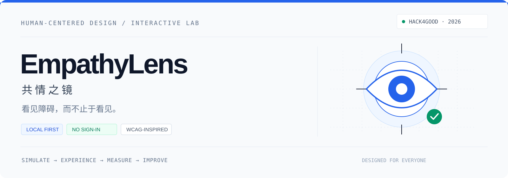
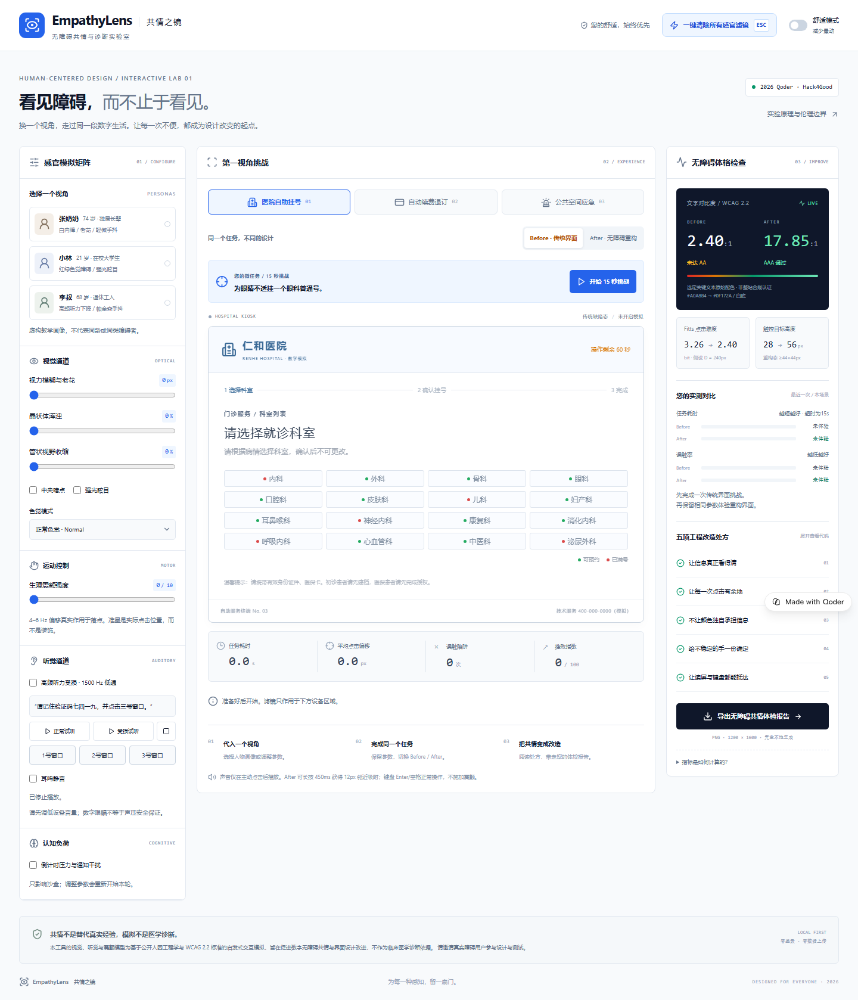
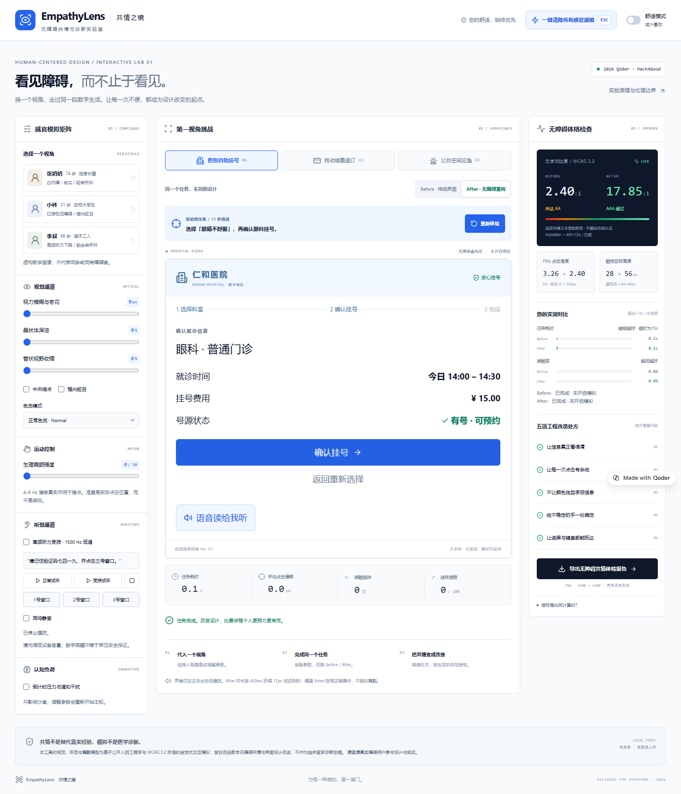
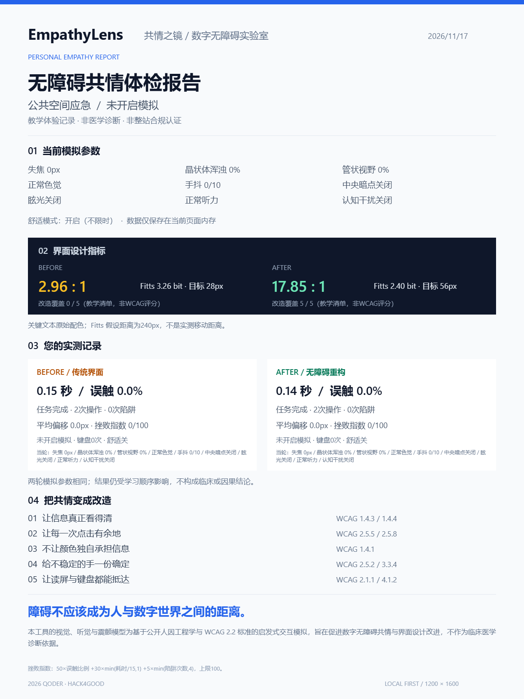

<div align="center">



### 感官障碍第一视角沉浸模拟 · 无障碍体格检查仪

让每一次不便，都成为设计改变的起点。

**[打开在线实验室](https://empathylens-m33wci77q34.qoder.zone)** · **[查看体检报告](docs/assets/empathy-report.png)** · **[公网验收记录](docs/public-verification.json)**

`React 19`　`TypeScript`　`Vite`　`Tailwind CSS`　`Web Audio`　`SVG + Canvas`

2026 Qoder 高校创造力大赛 · Hack4Good 技术向善赛道参赛项目

</div>

---

## 不是让人适应界面，而是让界面理解人

挂一个眼科号、关闭一项自动续费、辨认一个异常阀门——对一些人只是几次点击，对另一些人却是一道难以越过的门槛。

**EmpathyLens（共情之镜）**是一座可以亲手操作的数字无障碍实验室：代入感官差异，在现实场景中完成微任务，保留相同参数切换重构界面，再把体验转化为可执行的工程改造。

- **立即体验**：纯前端静态应用，无需注册或登录。
- **真实交互**：震颤改变实际命中坐标，不只是晃动的装饰。
- **可解释诊断**：区分实测数据、设计指标与教学启发式，不制造“医学评分”。
- **本地优先**：体验数据保留在页面内存；无分析追踪，刷新即清除。
- **安全退出**：`ESC` 一键停止声音并清除所有感官效果；舒适模式降低体验负担。



## 一分钟体验路线

1. 打开 **[公网实验室](https://empathylens-m33wci77q34.qoder.zone)**，选择一个人物画像。
2. 在 **Before** 中启动 15 秒挑战，尝试完成任务。
3. 保留感官参数，切换 **After**，体验同一个任务。
4. 比较耗时、平均落点偏移、误触与挫败指数，展开五项工程处方。
5. 导出一张 **1200 × 1600 PNG** 共情体检报告。

> 随时按 **ESC** 恢复。声音仅在主动点击后播放；请先调低设备音量。舒适模式取消超时失败、认知弹窗和动态准星，但保留运动模型参数。

## 三个场景，两种数字生活

| 场景 | Before · 传统缺陷态 | After · 无障碍重构态 |
| :--- | :--- | :--- |
| **医院自助挂号** | 低对比小字、密集科室按钮、单靠红绿区分号源、医保弹窗 | 症状选科向导、高对比大字、大热区、三重状态编码、离线语音引导 |
| **自动续费退订** | 诱导式补贴、默认连续包月、藏在角落的退订入口 | 透明账单、等权按钮、醒目金额、二次滑动确认与无需拖动替代 |
| **公共空间应急** | 红绿指示灯、密集报警日志、难辨的疏散出口 | Okabe–Ito 蓝橙配色、几何形状与条纹、明确文字、温和声光提示 |

**所有医院、支付、会员与应急数据均为教学模拟，不产生真实挂号、扣款、订阅或设备控制。**

<details>
<summary><strong>查看无障碍重构态截图</strong></summary>
<br />

</details>

## 感官模拟矩阵

| 通道 | 模型与实现 |
| :--- | :--- |
| **光学失焦** | 0–8px 高斯模糊；SVG `feGaussianBlur` |
| **晶状体浑浊与眩光** | 对比度衰减、Canvas 暖黄雾化、SVG `feTurbulence` 漫射 |
| **视野变化** | Canvas 中央暗点与周边视野遮罩；以指针位置近似注视点，无眼动追踪 |
| **色觉差异** | 正常、红色盲、绿色盲、蓝黄色盲、全色盲；线性 RGB 色觉矩阵 |
| **运动震颤** | 4.1–5.9Hz 连续正弦叠加、阻尼弹簧、0–10 级；抬起时用偏移后的真实坐标判定命中 |
| **听觉差异** | 同一段随站点打包的中文合成语音，受损态经过 1500Hz 低通；低音量提示音与可静音耳鸣 |
| **认知负荷** | 限时任务与沙盒内通知干扰；舒适模式可关闭 |

预设画像包括 **74 岁张奶奶、21 岁小林、68 岁李叔**。这些是虚构教学画像，不代表同龄人或同类障碍者的共同经历。

### 点击不是“看起来会抖”

```text
真实指针坐标
    + 4–6Hz 驱动的阻尼震颤偏移
    ↓
实际触控落点 → 热区命中判定 → 任务结果 / 误触统计
```

重构态支持长按 **450ms** 后在 **12px** 范围内吸附邻近目标；键盘 Enter / 空格保留正常语义操作，不人为施加指针震颤。支付滑动确认同时提供无需拖动的替代按钮。

## 诊断有依据，结果有边界

| 指标 | 定义 | 如何解读 |
| :--- | :--- | :--- |
| **WCAG 对比度** | `(L亮 + 0.05) / (L暗 + 0.05)`；先进行 sRGB 线性化 | 检查指定关键文本的原始设计色，不等于滤镜后感知或整页认证 |
| **Fitts 点击难度** | `log₂(1 + 240 / 目标高度)` | 距离固定假设为 240px；用于解释热区大小的影响，不是实测运动时间 |
| **误触率** | 错误或无效目标操作数 / 总操作数 | 来自当次实际交互，未完成的对照显示“未体验” |
| **平均点击偏移** | 指针落点偏移总距离 / 指针操作数 | 键盘操作单独计数，不混入指针偏移 |
| **挫败指数** | `50×误触比例 + 30×min(耗时/15,1) + 5×min(陷阱次数,4)`，上限 100 | 教学启发式，不是心理测量量表 |

当前关键文本设计配色的计算结果：

| 场景 | Before | After |
| :--- | ---: | ---: |
| 医院挂号 | 2.40 : 1 | 17.85 : 1 |
| 自动续费 | 1.95 : 1 | 17.85 : 1 |
| 公共应急 | 2.96 : 1 | 17.85 : 1 |

WCAG 2.2 普通文本 AA 对比度阈值为 **4.5:1**，AAA 为 **7:1**。触控目标 **44×44px** 对应增强目标 AAA；AA 最低目标为 **24×24px**，且存在标准列出的例外。本项目的主要重构操作采用更大的目标。

当两轮参数、舒适模式或输入方式不同，界面会提示**不是受控对照**。即使参数相同，也应注意练习顺序带来的学习效应。

## 带走一张共情处方

报告使用原生 Canvas 离线绘制，而非网页截图或第三方服务，包含当前模拟参数、两态实测记录、对比度与点击难度、五项改造建议和医学边界。

<div align="center">

</div>

样张中的数据来自自动化验收，不是受试者研究结果。

## 本地启动

建议使用 **Node.js 24 LTS** 与 npm。无需配置环境变量、API Key、数据库或后端服务。

```bash
git clone https://github.com/Waffing/EmpathyLens.git
cd EmpathyLens
npm ci
npm run dev
```

生产构建与预览：

```bash
npm run build
npm run preview
```

构建产物位于 `dist/`，可部署到支持静态文件的托管平台。运行时不加载外部图片、字体或音频；语音文件与应用一同部署，首次试听从本站读取。

### 验证与复现

```bash
# 15 组领域模型、状态和资源校验
npm run verify

# TypeScript 检查与生产构建
npm run build
```

完整浏览器回归使用 Python Playwright，并始终创建独立、无登录状态的浏览器上下文：

```bash
python -m pip install playwright
python -m playwright install chromium

# 先在另一终端启动 npm run dev
python scripts/browser-check.py
```

脚本默认访问 `http://127.0.0.1:5178`；启动时可使用 `npm run dev -- --port 5178 --strictPort`，或通过 `EMPATHY_URL` 指定其他地址。`EMPATHY_OUTPUT` 可指定证据目录，默认写入 `artifacts/`。

公网复验（Bash）：

```bash
EMPATHY_URL=https://empathylens-m33wci77q34.qoder.zone \
EMPATHY_OUTPUT=artifacts/public \
python scripts/browser-check.py
```

### 公网验收结果

已于 **2026-11-17** 在公开发布地址完成 **27 项 Chromium 浏览器检查**，包括：

- 全新无 Cookie 上下文直接打开，无需登录或重定向认证。
- 三个人物画像，三种场景的 Before / After 六条完成路径。
- 真实指针滑动确认、震颤偏移、Enter / Space 键盘操作。
- 15 秒超时、舒适模式、弹窗关闭、ESC 安全恢复。
- 正常与受损语音、1500Hz 低通频率响应、停止播放。
- 原生 Canvas 下载 PNG，并验证其 **1200×1600** 尺寸。
- 390px 移动端无横向溢出。
- **控制台错误 0、页面运行错误 0、外部资源请求 0。**

原始可复核结果见 **[docs/public-verification.json](docs/public-verification.json)**。这是特定时间和浏览器环境的验收记录，不是对所有设备或后续版本的绝对保证。

## 工程结构

```text
src/
├── components/
│   ├── SafetyBar.tsx          全局恢复与舒适模式
│   ├── SensoryConsole.tsx     人物画像与模拟参数
│   ├── FilterDefinitions.tsx  原生 SVG 滤镜
│   ├── HearingPreview.tsx     听觉对比与指令练习
│   ├── SandboxFrame.tsx       计时、真实落点和试验记录
│   ├── Scenes.tsx             三场景双态界面
│   └── Diagnostics.tsx        指标、处方与导出入口
├── lib/
│   ├── audio.ts              Web Audio 语音及安全生命周期
│   ├── filters.ts            色觉矩阵与光学参数
│   ├── tremor.ts             震颤模型与热区判定
│   ├── metrics.ts            对比度、Fitts 与实测指标
│   ├── report.ts             原生 Canvas 高清报告
│   ├── presets.ts            三种虚构人物画像
│   └── scenes.ts             场景配置与伦理声明
└── state/                    类型、reducer 与 React Context
public/audio/                 本站打包的中文语音
scripts/                      模型校验、浏览器回归、语音生成
docs/assets/                  仓库封面与真实截图
```

### 语音与素材

- 中文 WAV 在开发阶段使用 Windows 本机 `Microsoft Huihui Desktop` 离线合成，生成脚本为 `scripts/generate-audio.ps1`。
- 终端用户无需安装该语音，也不依赖浏览器的在线 TTS 服务。
- 页面使用系统字体、Lucide 图标、SVG 与 Canvas；不请求外部字体和媒体。
- 仓库展示图片来自实际运行截图。SVG 封面与 README 仅用于源码仓库，不进入站点构建。

## 医学、教学与隐私边界

> 本工具的视觉、听觉与震颤模型为基于公开人因工程学与 WCAG 2.2 标准的启发式交互模拟，旨在促进数字无障碍共情与界面设计改进，不作为临床医学诊断依据。

模拟不能替代障碍群体的真实经验，也不能据此推断某个人的能力。请邀请真实用户参与设计、可用性测试与改进评估。

应用不收集体验数据，不使用浏览器持久化存储保存试验记录。导出文件保存在用户设备；静态托管服务仍可能依据其服务策略处理常规访问日志。

色觉矩阵采用 Machado 等（2009）完全二色视的线性 RGB 近似；全色盲使用亮度灰度。模型、诊断说明和工程处方均应按教学用途理解。

仓库公开用于展示与学习查阅，目前未另行指定源码开源许可证；第三方依赖遵循各自许可证。

---

<div align="center">

**为每一种感知，留一扇门。**

由 Waffing 使用 Qoder 构建 · EmpathyLens / 共情之镜

[进入在线实验室](https://empathylens-m33wci77q34.qoder.zone)

</div>
